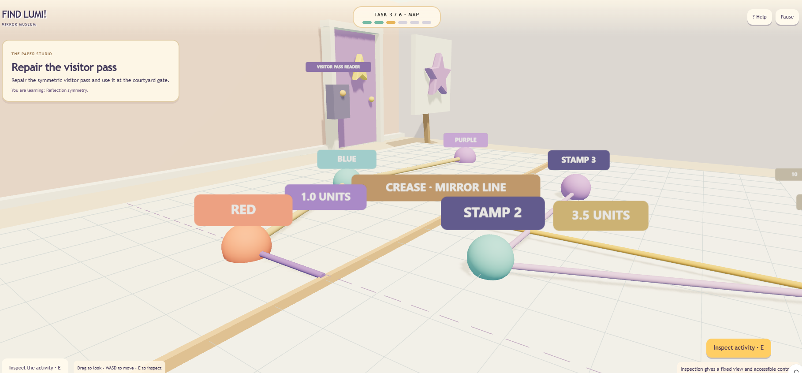
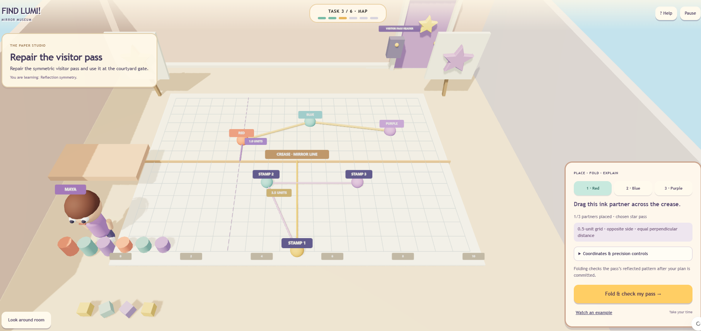

# Find Lumi — connected journey

**An educational real-time 3D puzzle-adventure about reflection.** Maya must open a route through a mirror museum to reach Lumi, reunite with her, and leave together — solving real optics and shortest-path problems along the way.

> ▶ **Play it now (no login or install):** https://bobbyhkg.github.io/find-lumi/

**Developed with 3D vision:** the whole museum is rendered in real-time 3D in the browser (Three.js / WebGL2). You can drag to look around, move with WASD/arrows, and inspect exhibits with E.

---

## About the course

| Requirement | This game |
|---|---|
| **STEM Topic** | Shortest paths and reflection |
| **Branch of STEM** | **Mathematics** (primary) — with Science (plane-mirror optics, ideal bank shots) and Engineering (optional mirror-design workshop) |
| **Description** | A six-task 3D adventure: use mirrors, reflection and shortest-path construction to open a route to Lumi, reunite with her, and guide her out of the museum. |
| **Learning outcomes** | Two (ABCD, below) |

**Audience:** junior secondary learners and beginner adults — no engineering background required. Captioned worked examples introduce angles, normals, perpendicular distance, reflected points and intersections; formal proof and trigonometry are not required.

### Learning outcomes

- **LO1 — Predict (conceptual):** Given four ideal reflection scenarios with incident paths and normal lines, the learner predicts the outgoing direction correctly in **at least 3 of 4 first attempts, within ±3°** (two bank shots in Task 2, two light directions in Task 6).
- **LO2 — Construct (procedural):** Given three unobstructed source–receiver diagrams on one side of a straight mirror, with grid, straightedge and intersection tools, the learner constructs a shortest one-reflection path correctly in **at least 2 of 3 first attempts**, with the reflected point B′ and the intersection P each **within 0.15 model units** plus a correct A–B′ connection (two constructions in Task 5, one in Task 6).

Each outcome has a single assessed action verb; first responses are recorded immutably, so help or retries never inflate the score.

---

## What the game covers — the six tasks

| Task | Concept / operation | What it unlocks |
|---|---|---|
| **1 — See beyond the wall** | Reflection, light paths, opaque obstacles — fit and turn two mirrors to get an unobstructed viewing ray | The live window reveals Lumi/Pip and the arcade passage sign |
| **2 — Open the arcade passage** | Normal, incidence/reflection angles — aim a catcher and test two ideal bank shots | Second successful catch releases the paper-studio barrier |
| **3 — Repair the visitor pass** | Mirror line, reflected partner, perpendicular distance — place three partners on a 0.5-unit grid, fold to check | The repaired pass opens the courtyard gate |
| **4 — Lift the gallery shutter** | Proposed vs physical ray; full one-bounce path length — predict and trace a bounce, then explain it | One successful beam lifts the shutter; Lumi becomes visible |
| **5 — Open the Star Gallery** | B′, straightedge, intersection, distance preservation — construct two new source–receiver layouts | Lights the approach, opens the gallery gate, and the reunion happens here |
| **6 — Home Together — Review and Apply** | Two familiar direction predictions + one construction on new layouts | Maya and Lumi follow the return markers and leave together — the outdoor ending |

The game is won only when Maya and Lumi **leave together**; a reunion alone is not the ending.

### Reference answers (fresh visit, run 0)

| Check | Answer |
|---|---|
| Task 1 viewer | Both mirrors fitted; 45° / 45° is a working finite-aperture configuration |
| Task 2 bank shots | Outgoing angles **61°**, then **56°** from the normal (opposite side) |
| Task 3 pass | Red **(2, −2.5)**, blue **(4.5, −1)**, purple **(7.5, −2)** — all three required |
| Task 4 bounce | A=(2,1), B=(8,3); bounce 2, **P=(3.5, 0)**; equal angles + shortest full path |
| Task 5 approach | A=(2,2), B=(8.5,2.5) → B′=(8.5,−2.5); **P = (44/9, 0) ≈ (4.889, 0)**; min length √62.5 ≈ 7.906 |
| Task 5 gate | A=(2,3), B=(8,2.5) → B′=(8,−2.5); **P ≈ (5.273, 0)**; min length √66.25 ≈ 8.139 |
| Task 6 directions | **45°**, then **40°** from the normal |
| Task 6 exit | A=(1.5,2.5), B=(8.5,1.5) → B′=(8.5,−1.5); **P = (5.875, 0)**; min length √65 ≈ 8.062 |

General same-side formula: **B′ = (Bx, −By)**, **P.x = (Ax·By + Bx·Ay) / (Ay + By)**, P.y = 0; minimum distance = A–B′.

---

## A note on the story

The story, characters (Maya, Lumi, Pip) and museum are **original fiction**. The pattern reader, catch-operated release and optical gates are fictional puzzle devices, but their geometry follows the stated mathematical models. The reflection theorem applies to the flat-mirror optical problems; the museum map is adventure progress, not a maze-shortest-path claim.

---

## How to play

- **Online (recommended):** https://bobbyhkg.github.io/find-lumi/ — opens in any WebGL2 browser.
- **Offline:** double-click `PLAY-LOCALLY.cmd` (requires Node.js), then open http://127.0.0.1:4194/. No dependency install, build or account needed.

**Controls:** drag pieces (or use precision sliders / arrow keys); drag to look, WASD/arrows to move, E to inspect. No timer or lives gate learning. Larger text, reduced motion, captions and optional sounds are available in Settings.

---

## For reviewers

`TEACHER_GUIDE.md` holds the full ABCD outcome breakdown, instructional strategies, model limits, accuracy boundaries, references, and all default answers. `DESIGN.md` documents the six-task journey and version-4.1 refinements.

---

## Development

Static site with no build step — `dist/` is both source and deployable (GitHub Pages serves `dist/`). `npm start` runs the local server; `npm test` runs the Node-only maths/assessment tests; `npm run check` validates module syntax; Playwright browser QA uses `npm run test:browser` plus `tests/navigation.mjs` and `tests/visual.mjs`. Three.js 0.187.0 (MIT) is vendored under `dist/vendor/`.
